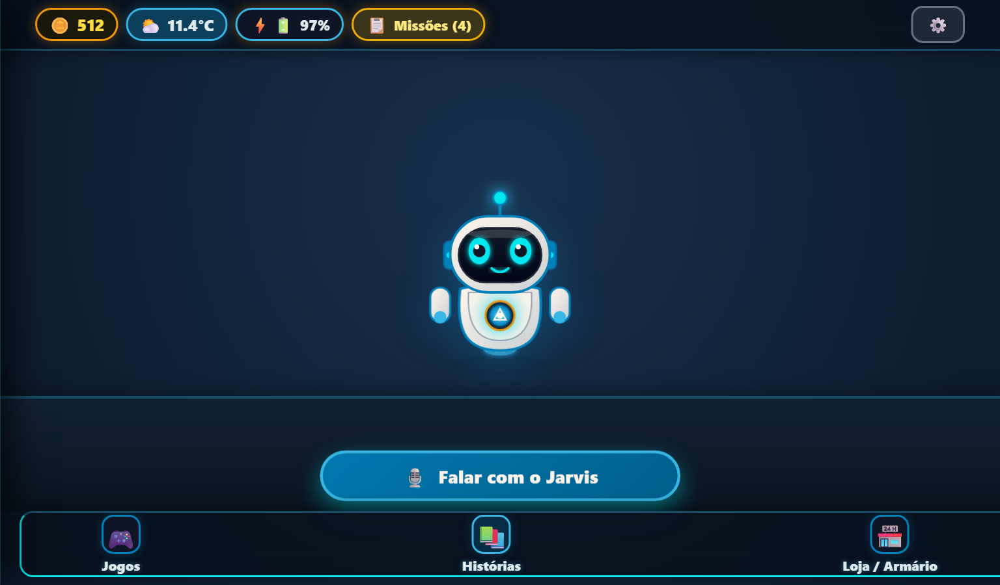
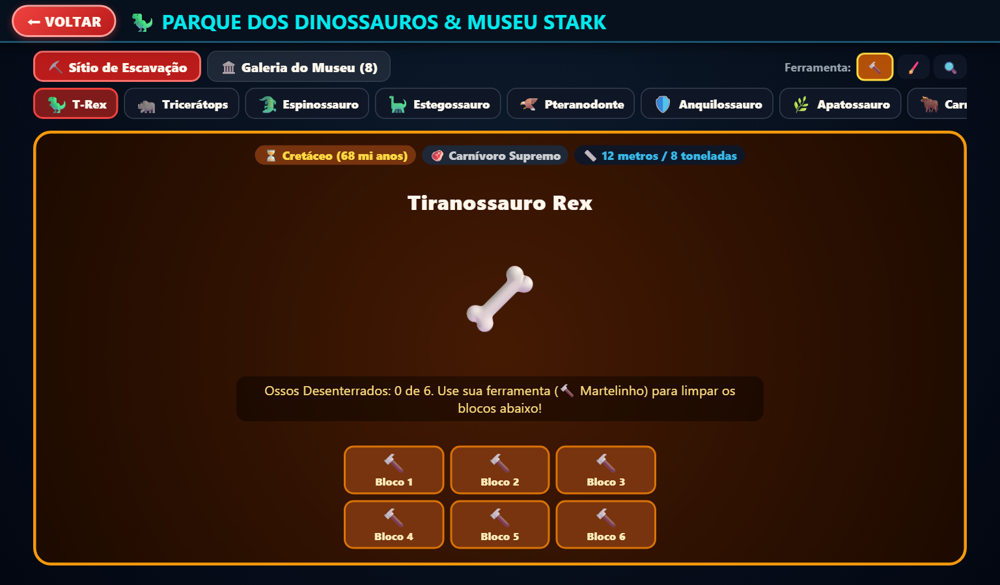
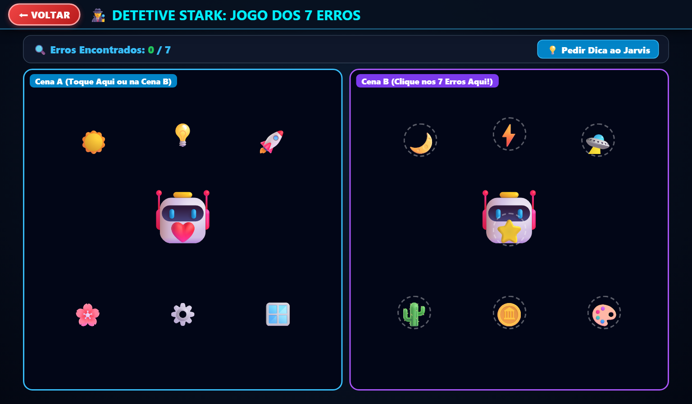
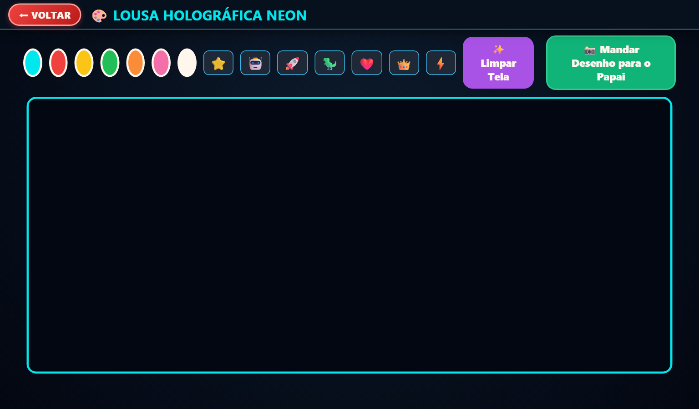
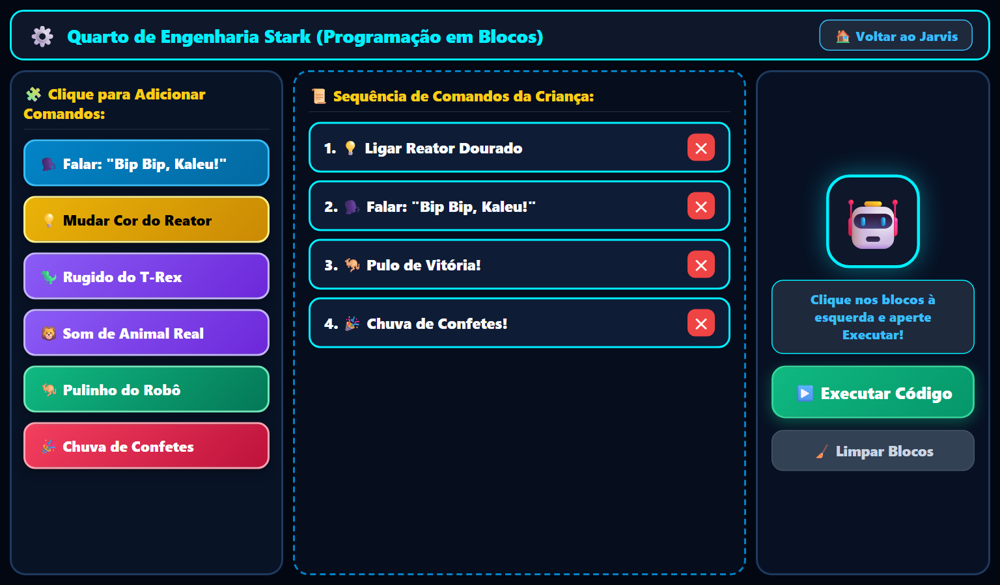

# 🚀 J.A.R.V.I.S. Kids OS v3.9.0 — Edição Stark Edge & Multi-IA (OpenCode, Ollama Local & Visão Humana)

Sistema operacional educativo, companheiro emocional e assistente gamificado estilo **JARVIS do Homem de Ferro**, projetado sob medida com princípios de engenharia de software de alta eficiência para netbooks modestos e computadores com recursos restritos (modelo original **Acer Aspire One / Asus Eee PC** com `Intel Atom 1.6 GHz`, `1 GB a 2 GB RAM`, tela `1024x600`), expandido para arquitetura **multiplataforma universal** compatível com **Linux Kiosk**, **Windows Desktop**, **macOS (.app)** e **Android (.apk autônomo offline)**!

---

## 📸 Galeria Visual do Sistema em Execução (Screenshots Oficiais 1024x600)

Telas reais capturadas diretamente do sistema em execução na resolução nativa do netbook (1024x600):

| 🤖 1. HUD Principal — Sala de Comando do Robô Jarvis | 🦸‍♂️ 2. Quartel-General das Missões do Herói |
| :---: | :---: |
|  |  |
| *Mascote Jarvis interativo em tela desobstruída e limpa, clima em tempo real, moedas do Pote do Tesouro, bateria e barra inferior com Jogos, Histórias e Loja.* | *Quartel-General de Missões reformulado com barra de conquista diária de super-herói, abas de filtro (Todas, Para Fazer, Concluídas) e atalhos rápidos.* |

| 📚 3. Biblioteca Mágica de Histórias (Estante) | 🌟 4. Tela de Conquista & Celebração do Livro |
| :---: | :---: |
|  |  |
| *Estante de livros ilustrados infantis organizados com capas táteis, temas pedagógicos de virtudes, valores e gerador de histórias com IA.* | *Tela de Conquista com chuva de confetes 2D, moral da história destacada, voz amigável de parabéns do Jarvis e 3 botões gigantes de alta visibilidade.* |

| 🦖 5. Parque dos Dinossauros & Sítio Paleontológico | 🕵️ 6. Detetive Stark (Jogo dos 7 Erros) |
| :---: | :---: |
|  |  |
| *Escavação fóssil interativa com martelinho, pincel e super lupa, além de rugidos pré-históricos autênticos e fatos científicos adaptados para crianças.* | *Desafio visual de atenção e foco com contador tátil progressivo, efeitos sonoros imersivos e incentivos falados pelo robô Jarvis.* |

| 🎨 7. Lousa Mágica Neon & Carimbos Colecionáveis | 📱 8. Painel Administrativo dos Pais (`/admin`) |
| :---: | :---: |
|  |  |
| *Quadro de desenho digital com pincéis neon vibrantes, borracha tátil, carimbos colecionáveis e reconhecimento inteligente do que a criança desenhou.* | *Painel dos pais com indicador de Wi-Fi, auto-salvamento de motores de IA (Ollama, OpenCode, Gemini, OpenAI, Groq), controle de tempo de tela e mensagens.* |

| 🏎️ 9. Corrida Turbo Stark (Super Piloto dos Campeões) |
| :---: |
|  |
| *Pista de corrida arcade interestelar neon: a criança pilota o super carro Stark desviando de obstáculos, coletando moedas de ouro e ativando o Super Nitro até a linha de chegada!* |

---

## 🌟 Novidades da Versão 3.9.0 (Arcade Stark 2D, Pista Infinita & Alimentação Interativa)

### 📸 1. Espelho Mágico com Desligamento Total da Câmera & 10 Carinhas Expressivas
- **Desligamento Confiável da Câmera:** Ao fechar o modal, voltar à sala do Jarvis ou trocar de aba, todos os tracks de mídia são finalizados (`track.stop()`) e `video.srcObject = null` é executado, apagando a luz física da webcam do netbook de forma instantânea.
- **Botão Manual de Segurança:** Inclusão do botão `🔴 Desligar Câmera` no topo do espelho para encerramento manual em um clique.
- **10 Carinhas Expressivas:** O cardápio de desafios faciais foi expandido para 10 opções ricas e divertidas (😄 Alegre/Sorrindo, 😲 Surpreso, 😌 Calmo/Focado, 😠 Valente/Corajoso, 😉 Piscadela de Campeão, 😜 Careta com a Língua, 🦸‍♂️ Pose de Super-Herói Stark, 😍 Carinho/Beijinho, 🥱 Bocejo Gostoso, 🤪 Careta Maluquinha).
- **Seletor Rápido de Carinhas:** A criança pode tocar diretamente em qualquer emoji da barra para praticar a carinha que quiser sem esperar sorteio.

### 🏪 2. Loja do Tesouro & Animação de Alimentação/Recarga do Jarvis
- **Comidas Recontextualizadas para Robô:** Substituição de alimentos genéricos por itens tecnológicos de alta energia para o robô: 🔋 Bateria Quântica de Plasma, 💠 Célula Arc Stark, ⚡ Picolé de Eletricidade Cósmica, 🛢️ Óleo Super Turbo Stark, 🍪 Biscoito Nanotec de Chocolate, 🧪 Hiper-Combustível Stark, 🍏 Maçã Biocibernética e 🍕 Micro-Pizza Termonuclear.
- **Animação Interativa de Alimentação:** Ao comprar qualquer item de energia, uma janela holográfica animada surge sobre a loja: o item voa até a boca/reator do Jarvis, sons crocantes e elétricos Web Audio são disparados, o Reator Arc brilha com feixes azuis, a barra de energia enche para 100% com flash verde e o Jarvis agradece alegremente com fala sintetizada!
- **Navegação em Abas Sem Bugs:** A troca de abas (`Armário do Jarvis` e `Tesouro Real`) e compra de itens agora atualizam o conteúdo em tempo real sem reempilhar telas na `modalNavStack`.
- **Botão Duplo no Cabeçalho:** O cabeçalho dos modais conta agora com `⬅ VOLTAR` (volta 1 nível) e `🏠 SALA DO JARVIS` (fecha direto para a tela inicial em 1 clique).

### 🏎️ 3. Corrida Turbo Stark (Pista Infinita & 3 Níveis de Velocidade)
- **Seletor de Níveis de Velocidade:** Permite alternar a qualquer momento entre 🟢 Fácil (80 km/h), 🟡 Veloz (140 km/h) e 🔴 Super Turbo Insano (220 km/h).
- **Pista Infinita Contínua:** O piloto não é interrompido aos 1000m; o odômetro registra a distância total percorrida e a cada 500 metros ultrapassados premia a criança com +1 moeda de bônus, fanfarra e elogio especial do Jarvis.
- **Finalização e Troféu:** Botão `🏆 Finalizar Recorde` para registrar o recorde e receber o grande troféu dourado.

### 🕹️ 4. Página 8 com 4 Novos Super Jogos Arcade Stark (Lógicas Totalmente Diferentes!)
A **Página 8** na Central de Jogos traz 4 jogos de ação rápida e arcade com jogabilidades e mecânicas 100% distintas entre si e da Corrida Turbo:
1. 🚀 **Defensor Galáctico Stark (Shoot 'Em Up Arcade):** Batalha espacial clássica com nave interceptora Stark, ondas de drones que descem em formação ondulada, lasers duplos e rajada fulminante com o botão Turbo Laser!
2. ⚡ **Reator Arkanoid Stark (Brick Breaker / Quebra-Blocos):** Desafio quântico de rebatida na base magnética, física de ricochete angular, 32 blocos de vibranium e power-ups (Esfera Turbo Perfurante, Super Base Stark, Multi-esferas e Moedas de Ouro)!
3. 🦸‍♂️ **Jetpack Repulsor Stark (Voo Gravitacional & Flappy):** Impulso vertical com os jatos do Homem de Ferro lutando contra a gravidade, desviando de portais de laser, recolhendo moedas e atravessando anéis turbo em velocidade supersônica invencível!
4. 💠 **Circuito Neon Stark (Cobrinha Quântica Turbo / Tron):** Arcade em grade 2D com D-Pad tátil e suporte a teclado, coleta de núcleos energéticos, auto-wrap suave nas paredes e botão Turbo Sprint com o dobro de velocidade e pontuação!

---

## 🌟 Novidades da Versão 3.8.0 (Edição Multi-IA, Visão Local & Ergonomia Lateral)

### 🤖 1. Seletor de Inteligência Artificial com Auto-Salvamento Instantâneo
- **⚡ OpenCode CLI (Recomendado/Prioritário):** Execução autônoma de código e geração com o utilitário CLI OpenCode (`opencode run`) diretamente no netbook ou servidor LAN.
- **🏠 IA Local com Ollama (100% Offline & Grátis):** Modelos locais ultraleves (`llama3.2:1b` e `qwen2.5:0.5b`) rodando em `http://127.0.0.1:11434` sem custos de API, sem envio de dados para a internet e sem travamentos.
- **☁️ Opções Externas na Nuvem:** Conexão nativa e simplificada com **Google Gemini** (`gemini-3.8-flash` / `gemini-2.5-flash`), **OpenAI ChatGPT** (`gpt-4o-mini`) e **Groq Cloud** (`llama-3.3-70b-versatile` com inferência ultra-rápida gratuita).
- **💾 Salvamento Instantâneo em 1 Toque:** Ao clicar na aba de qualquer motor no Painel dos Pais, o sistema dispara imediatamente `POST /api/config`, persistindo `active_provider` e `mode` no arquivo `config.json` e na memória do Jarvis, com banner verde de confirmação instantânea.
- **Botões Dedicados por Cartão:** Cada motor conta com botões próprios de `💾 Salvar Configurações` e `⚡ Testar Conexão`, além de links diretos para chaves gratuitas (Google AI Studio e Groq Console).

### 🦸‍♂️ 2. Grounding e Enciclopédia Infantil de Super-Heróis no Jarvis
- **Respostas Precisas sobre Personagens Famosos:** O Jarvis agora ensina com alegria, clareza e precisão quem são os heróis dos quadrinhos e filmes:
  - *Homem-Aranha:* Peter Parker, que escala paredes, solta teias e protege a cidade com bom humor;
  - *Homem de Ferro:* Tony Stark, inventor genial que criou sua armadura de alta tecnologia com Reator Arc no peito;
  - *Batman:* Bruce Wayne, herói inteligente de Gotham City com Batmóvel e bat-bumerangues;
  - *Hulk:* Bruce Banner, cientista de bom coração que vira um gigante verde super forte para proteger os amigos;
  - *Capitão América:* Steve Rogers, líder dos Vingadores com escudo indestrutível com estrela;
  - *Flash:* Barry Allen, o herói mais veloz do mundo que corre como um raio;
  - *Super-Homem:* Clark Kent, vindo de Krypton com super força e capa vermelha.
- **Eliminação de Bug de Substring ("oi"):** Correção estrita com regex de limite de palavra (`\b(oi|olá|...)\b`), impedindo que a palavra "super-her**oi**" seja interpretada erroneamente como cumprimento genérico.
- **Fallback Enciclopédico de Heróis:** Mesmo se o netbook estiver sem internet e o modelo local estiver em inicialização fria, o Jarvis possui respostas nativas gravadas com 0ms de latência.

### 👁️ 3. Visão Computacional Local de Borda com `@vladmandic/human`
- **Biblioteca Embarcada 100% Local:** Modelos de visão (`blazeface`, `emotion`, `handtrack`, `handlandmark-lite`) instalados diretamente em `static/libs/human/` (8.3 MB), sem necessidade de downloads de CDN ou envio de frames para servidores externos.
- **Espelho das Emoções:** Reconhecimento facial inteligente de sorrisos e carinhas com limiar dinâmico adaptativo, detecção de felicidade/sorriso imediata, feedback sonoro e botão de confirmação instantânea para não travar a brincadeira da criança.
- **Mãozinhas na Câmera & Mestre da Matemática:** Detecção tátil de dedinhos levantados direto na webcam para desafios matemáticos e contagem progressiva.
- **Zero Lag no Intel Atom N450:** Sistema de trava de processamento (`isProcessing` guards) com descarte automático de frames sobrepostos (*frame dropping*), mantendo a interface nos 60 FPS estáveis.

### 🎮 4. Corrida Turbo Stark & Novos Jogos Educativos
- **🏎️ Corrida Turbo Stark (Super Piloto dos Campeões):** Jogo de corrida arcade interestelar neon ultra-fluido:
  - **Jogabilidade Ativa em 3 Faixas:** A criança pilota a máquina Stark usando as setinhas `←` `→`, o mouse ou tocando diretamente nas faixas da pista na tela touch do netbook.
  - **Coleta de Moedas & Estrelas:** Pegue moedas douradas (+1 moeda no pote), estrelas de ouro e baterias de Reator Arc para recarregar o Nitro!
  - **🔥 Super Nitro Turbo (240 km/h):** Aceleração máxima com rastro de chamas azuis, atração magnética de moedas próximas e som de turbina potente.
  - **🏁 Grande Prêmio Stark (1000m):** Ao cruzar a linha quadriculada de chegada, chuva de confetes 2D, troféu dourado gigante, elogio do Jarvis e premiação real de +3 moedas de ouro!
- **➕ Mestre da Matemática:** Operações de adição (+), subtração (-), multiplicação (×) e divisão (÷) com maçãs, estrelas e suporte à contagem de dedinhos na câmera.
- **🦖 Parque dos Dinossauros com Sons Autênticos:** Sons e rugidos reais e organização lateral ergonômica, mantendo a tela do netbook (1024x600) sempre limpa e desobstruída.
- **🦁 Expedição dos Bichos Expandida:** Mais animais com áudios reais capturados da natureza e Desafio do Ouvido.
- **🗣️ Fonoaudiologia & Dicção Aprimorada:** Botão "Ouvir Jarvis" falando a palavra inteira e botão separado para soletrar pausadamente sílaba por sílaba com dica articulatória da boquinha.
- **🔇 Desligamento Instantâneo de Áudio ao Sair de Jogos:** Ao fechar qualquer jogo para retornar à dashboard central, todos os sons, rugidos e sintetizadores são encerrados imediatamente, garantindo silêncio limpo e zero poluição sonora no ambiente.

---

## 🌟 Novidades da Versão 3.7.0 (Stark Edge AI & Aceleração TensorFlow Lite)

Inspirado na arquitetura do **TensorFlow Lite**, **XNNPACK** e **QuickDraw**, o sistema conta com visão computacional de borda e reconhecimento de voz instantâneo projetados para não consumir CPU nem RAM no **Intel Atom N450**:

### 🔮 1. Lousa Mágica Inteligente com Visão de Desenhos (QuickDraw Edge)
- **Botão `🔮 O que o Jarvis vê?`:** A criança desenha livremente na Lousa Neon e clica no botão mágico. A IA de borda analisa a imagem instantaneamente e o Jarvis reconhece o que foi desenhado (*Sol, Estrela, Coração, Foguete, Casinha, Dinossauro, Peixinho, Florzinha*).
- **Elogio Falado & Recompensa Gamificada:** O Jarvis fala em voz alta elogiando a imaginação do pequeno herói (*"Bip bip, super Kaleo! O Jarvis viu que você desenhou um lindo Sol radiante e quentinho!"*), dispara confetes 2D e adiciona +2 moedas de ouro no Pote do Tesouro.
- **Suporte Total a Touch:** Adicionado suporte nativo a toques de dedos na tela (`touchstart`, `touchmove`, `touchend`), permitindo desenhar com os dedinhos em netbooks touch, tablets e smartphones.

### 📸 2. Desafio dos Dedinhos com Câmera Mágica (Hand Vision)
- **Aba `📸 Mãozinha na Câmera (IA)`:** A criança coloca a mãozinha na frente da webcam do netbook e o Jarvis detecta e conta os dedinhos levantados (de 1 a 5).
- **Amostragem Ultraleve (380ms):** A visão computacional processa em miniatura (80x60) com espaçamento temporal seguro, garantindo **0% de travamento na CPU** do Atom e mantendo os 60 FPS da interface do quiosque.
- **Feedback por Voz em Tempo Real:** Conforme a criança mexe os dedinhos, o mostrador numérico se atualiza e o Jarvis comemora por voz!

### ⚡ 3. Ativação de Voz Instantânea Offline (Fast Keyword Spotter em 10ms)
- **Resposta em 10 milissegundos:** Comandos diretos da criança (*"jogos"*, *"livro"*, *"desenhar"*, *"dedinhos"*, *"loja"*, *"dinossauro"*, *"música"*, *"escovar dente"*, *"bom dia"*, *"boa noite"*) são reconhecidos localmente de imediato.
- **100% Funcional sem Internet:** Se a rede Wi-Fi cair, a criança continua conversando e abrindo todas as atividades por voz sem travar na tela de escuta.

---

## 🖥️ Especificações de Hardware & Requisitos do Sistema

O **J.A.R.V.I.S. Kids OS** nasceu com uma premissa de engenharia intransigente: **dar vida útil e propósito nobre a computadores antigos e modestos**, transformando um netbook esquecido em um superassistente educativo com inteligência artificial para o aprendizado e desenvolvimento de uma criança.

### 🎯 Hardware Alvo Original de Desenvolvimento
O sistema foi concebido, calibrado e testado originalmente para a linha de netbooks ultra-compactos:
- **Modelo de Referência Principal:** Netbook **Acer Aspire One (532h / D250 / D255)** e **Asus Eee PC (1005 / 1015)**.
- **Processador (CPU):** Intel Atom N450 / N270 / D2500 (1.60 GHz a 1.66 GHz, 1 Núcleo / 2 Threads, x86/x64).
- **Memória RAM:** 1 GB a 2 GB DDR2 / DDR3.
- **Gráficos (GPU):** Intel GMA 3150 / Intel 945GSE integrada (aceleração gráfica 2D básica).
- **Armazenamento:** HDD ou SSD SATA de 160 GB, ou cartão de memória SD.
- **Tela e Resolução:** 10.1 polegadas WSVGA (1024 x 600 pixels) com preenchimento total e modo quiosque tela cheia.
- **Sistema Operacional Recomendado:** **antiX Linux 23/24 (32 bits ou 64 bits)** ou **Windows 7/10 Home**.

---

### 📊 Tabela de Requisitos de Sistema (Mínimos vs. Recomendados)

| Componente | Requisitos Mínimos (Netbook Acer / Asus / PCs Antigos) | Requisitos Recomendados (PCs / Notebooks Modernos) |
| :--- | :--- | :--- |
| **Processador (CPU)** | Intel Atom 1.6 GHz, Intel Celeron antigo, AMD E-Series ou qualquer processador x86/x64 de 1 núcleo | Intel Core i3 / i5, AMD Ryzen 3 / 5 ou Celeron moderno quad-core |
| **Memória RAM** | **1 GB de RAM** *(o backend Microdot consome apenas ~12 a 25 MB de RAM)* | **4 GB a 8 GB de RAM** *(para rodar IA local com Ollama de 1B a 3B)* |
| **Armazenamento** | **500 MB livres** em disco ou cartão SD | **4 GB a 10 GB livres** *(para pesos dos modelos locais de IA)* |
| **Resolução de Tela** | **1024 x 600 pixels** (10.1") com preenchimento total responsivo sem scrollbars | **1366 x 768**, **1920 x 1080 (Full HD)** ou superior |
| **Áudio & Microfone** | Microfone integrado e alto-falantes estéreo / saída P2 | Microfone USB com cancelamento de ruído e caixas de som |
| **Conexão de Rede** | Wi-Fi 802.11 b/g/n (para síntese de voz neural e APIs na nuvem) | Conexão Wi-Fi ou Ethernet estável |
| **Sistemas Operacionais** | **antiX Linux** (32/64 bits), **Debian minimal**, **Raspberry Pi OS**, **Windows 7/10/11**, **Android**, **macOS** | Windows 10/11, Ubuntu/Debian, Fedora, macOS Sonoma/Sequoia, Android 10+ |

---

## 📦 Matriz de Pacotes & Downloads Oficiais (GitHub Releases)

Os arquivos compilados são gerados automaticamente pelo [GitHub Actions CI/CD](https://github.com/zetra-mini/O.S-EDUCATIVO-PARA-CRIAN-AS/actions) e disponibilizados na aba de **Releases**:

| Formato | Plataforma Alvo | Arquivo de Download | Como Instalar / Executar |
| :--- | :--- | :--- | :--- |
| 🐧 **.deb** | Debian / antiX / Ubuntu / Raspberry Pi OS | `jarvis-kids-os_3.9.0.deb` | `sudo dpkg -i jarvis-kids-os_3.9.0.deb` |
| 📦 **.tar.gz** | Linux Kiosk Standalone (Netbook Atom) | `jarvis-kids-os-3.9.0-linux-desktop.tar.gz` | `tar -xzf jarvis-kids-os-*.tar.gz && ./iniciar_jarvis_linux.sh` |
| 🪟 **.zip** | Windows 7 / 10 / 11 (Desktop) | `jarvis-kids-os-3.9.0-windows-desktop.zip` | Extrair e clicar em `iniciar_jarvis_windows.bat` |
| 📱 **.apk** | Android Celulares & Tablets Infantis | `jarvis-kids-os-3.9.0-android.apk` | Instalar no Android e permitir microfone (Modo Autônomo Offline Nativo) |
| 🍏 **.app** | macOS (Intel & Apple Silicon M1/M2/M3) | `jarvis-kids-os-3.9.0-macos.app.zip` | Extrair e abrir `JARVIS-Kids-OS.app` |
| 📱 **PWA** | Smartphone dos Pais (iOS / Android) | Acesso direto via navegador | Acessar `/admin` e clicar em *Adicionar à Tela Inicial* |

---

## ⚡ Engenharia de Performance & Hardware Restrito

### 1. Servidor Web Ultraleve com Microdot (< 15 MB de RAM)
- O backend opera sobre o **Microdot**, micro-framework assíncrono de pegada de memória mínima.
- **Consumo real medido:** Apenas **9 a 14 MB de RAM**, operando com folga muito abaixo do teto de 30 MB.
- Servido nativamente na porta `http://127.0.0.1:8000`.

### 2. SQLite em Modo WAL & Arquitetura de Acesso Seguro
- Para evitar a falha `SQLITE_BUSY` e o congelamento do disco/SSD por acessos simultâneos, todas as conexões SQLite injetam no momento da abertura:
  ```sql
  PRAGMA journal_mode = WAL;     -- Write-Ahead Logging: leituras e escritas não bloqueiam umas às outras
  PRAGMA synchronous = NORMAL;   -- Reduz chamadas excessivas de fsync ao disco
  PRAGMA temp_store = MEMORY;    -- Força tabelas temporárias e ordenações na memória RAM
  PRAGMA busy_timeout = 5000;    -- Espera até 5 segundos em caso de concorrência antes de falhar
  ```

### 3. Eliminação Absoluta de Áudio sobre Áudio
- Toda emissão de voz neural (`speak()`), chime sonoro ou áudio de jogo aciona previamente `pararTodosAudiosESpeech()`, cancelando requisições TTS em andamento e silenciando sintetizadores e tags de áudio para garantir que nunca ocorra sobreposição de falas.

### 4. Zero Scrollbars & Paginação Tátil Ergonômica
- Todas as interfaces (HUD, Loja, Biblioteca, Prato dos Campeões, Central de Jogos e Academia de Dicção) utilizam containers flexbox com `overflow: hidden; max-height: calc(100vh - 72px)` e navegação anterior/próxima em botões de alta visibilidade, eliminando completamente barras de rolagem.

---

## 🐧 Inicialização Automática no Boot (antiX Linux & Netbooks Dedicados)

Uma das maiores vantagens do JARVIS Kids OS quando instalado no **antiX Linux** (especialmente no Acer Aspire One, Asus Eee PC ou PCs antigos) é a experiência de **Console Educativo Dedicado** (estilo videogame ou eletrodoméstico):

### 🚀 Instalação com 1 Comando no antiX Linux (100% Automático):
Basta baixar o arquivo `.deb` da versão mais recente nas Releases e executar no terminal do antiX:

```bash
sudo dpkg -i jarvis-kids-os_3.9.0.deb || sudo apt-get install -f -y
```

Ou usando o comando do `apt`:
```bash
sudo apt install ./jarvis-kids-os_3.9.0.deb
```

**Pronto! A partir desse momento, tudo é 100% automático:**
- **Zero configuração manual:** Não precisa ativar servidor pelo terminal toda vez que ligar o netbook.
- **Início Automático no Boot:** O instalador configura o serviço e sobe sozinho em tela cheia (modo quiosque 1024x600).
- **Sem senhas ou distrações:** A criança vê apenas o robô Jarvis e suas atividades educativas.

---

## 🎮 Catálogo dos 24 Jogos & Atividades Educativas (6 Páginas 2x2)

### 📄 Página 1: Alfabetização, Matemática e Linguagens
1. **📚 Biblioteca Mágica de Histórias:** Livros ilustrados interativos e histórias com decisões morais.
2. **🔤 Ler & Escrever (Método Fônico):** Sons de cada letra do alfabeto e escrita na lousa neon.
3. **🖐️ Desafio dos Dedinhos:** Matemática visual e contagem de 1 a 10 com mãozinhas animadas e câmera.
4. **🌍 Idiomas Mágicos (English & Español):** Cartões falantes em 3 idiomas e miniquiz com moedas reais.

### 📄 Página 2: Nutrição, Higiene, Arte e Música
5. **🍎 Prato dos Super Campeões:** Educação alimentar lúdica com os 4 grupos de nutrientes essenciais.
6. **🧼 Super Herói Limpinho (Higiene):** 4 missões práticas de autocuidado (dentes, banho, mãos e unhas).
7. **🎨 Pintura & Lousa Mágica Neon:** Lousa artística com pincéis coloridos, carimbos colecionáveis e visão IA.
8. **🎵 Laboratório Musical Stark:** Teclado Dó-Ré-Mi, bateria de ritmo e músicas infantis guiadas.

### 📄 Página 3: Tecnologia, Cultura e Informação
9. **💻 Academia Tech: Mouse, Teclado & Scroll:** Foguete (scroll up), Submarino (scroll down), mira e clique.
10. **🇧🇷 Festas & Datas Comemorativas do Brasil:** Celebrações culturais brasileiras no calendário interativo.
11. **🎬 Cinema & Desenhos Stark:** Gestão segura de tempo de vídeo no YouTube Kids e Netflix com trava de leitura prévia.
12. **🌤️ Clima, Geografia & Meu Lugar no Mundo:** Sua cidade, estado, Brasil, mapa e as 4 estações do ano.

### 📄 Página 4: Mente, Emoções e Cognição
13. **🚦 Desafio do Semáforo Stark:** Treino de atenção rápida, reflexos e controle inibitório.
14. **💚 Flor da Calma & Espelho das Emoções:** Respiração guiada, identificação de sentimentos e câmera de expressões faciais.
15. **📦 Baú Leitner da Memória:** Repetição espaçada e memorização inteligente de fatos e conceitos.
16. **🔷 Cores, Formas & Lógica Espacial:** Geometria lúdica com círculos, quadrados, triângulos e estrelas.

### 📄 Página 5: Dicção, Espaço, Natureza e Tempo
17. **🗣️ Fonoaudiologia & Dicção do Super-Herói:** 66 desafios de fala com sílabas neon, dica da boquinha, fala pausada e sorteio de palavras mágicas pelo robô Jarvis!
18. **🪐 Sistema Solar & Planetas do Universo:** Pilote a nave espacial, visite planetas (Marte, Júpiter, Saturno), aprenda curiosidades espaciais e dispute o Quiz Astronauta.
19. **🦁 Reino Animal & Sons da Natureza (Biólogo Stark):** Conheça os animais, ouça sons característicos sintetizados e adivinhe o bicho pelo som no Desafio do Ouvido!
20. **⏰ O Relógio Mágico do Tempo & Horas:** Mostrador analógico e digital interativo, ciclo visual dia/noite e missões de rotina (hora de acordar, almoçar e dormir).

### 📄 Página 6: Raciocínio, Ciências, Estratégia e Robótica
21. **🕵️ Detetive Stark: Jogo dos 7 Erros:** Olhos de águia para encontrar detalhes secretos em cenas de alta visibilidade com incentivos do Jarvis.
22. **🔬 Laboratório de Misturas & Ciências:** Misturador de cores primárias, termômetro dos 3 estados da água (gelo, líquido, vapor) e o super ímã magnético.
23. **♟️ Academia de Xadrez do Pequeno Mestre:** Aprenda o movimento do Peão, Cavalo em L, Torre e grandes jogadas com mini-tabuleiro interativo e dicas do Jarvis.
24. **🏎️ Corrida Turbo Stark:** Pista interestelar neon com desvio de obstáculos, 3 níveis de velocidade, pista infinita e cofre de moedas!

### 📄 Página 7: Super Velocidade, Aventura & Sustentabilidade
25. **🏎️ Corrida Turbo Stark (Endless Highway):** Pista interestelar neon com odômetro infinito e marcos de 500m.
26. **🌍 Reciclagem do Planeta Stark:** Classificação ecológica e missões de coleta seletiva para salvar o meio ambiente.

### 📄 Página 8: Super Jogos de Ação & Arcade Stark (Lógicas Únicas!)
27. **🚀 Defensor Galáctico Stark:** Tiro espacial estilo invasores com ondas de drones, lasers e modo Turbo Laser.
28. **⚡ Reator Arkanoid Stark:** Quebra-blocos quântico com física de ricochete, base magnética e power-ups.
29. **🦸‍♂️ Jetpack Repulsor Stark:** Voo gravitacional com propulsores do Homem de Ferro, portais e anéis de aceleração turbo.
30. **💠 Circuito Neon Stark:** Cobrinha quântica em grade 2D com D-Pad tátil, auto-wrap e Turbo Sprint!

---

## 🚀 Como Executar Localmente (Desenvolvimento & Testes)

### Pré-requisitos (Modo Dev)
- Python 3.10 ou superior
- Navegador moderno (Chromium, Chrome, Edge ou Firefox)

### Instalação em Modo de Desenvolvimento
```bash
git clone https://github.com/zetra-mini/O.S-EDUCATIVO-PARA-CRIAN-AS.git
cd O.S-EDUCATIVO-PARA-CRIAN-AS
pip install -r requirements.txt
```

### Inicialização Manual do Servidor
```bash
python run_server.py 8000
```
- Interface da criança (Modo Kiosk): `http://localhost:8000`
- Painel Administrativo dos Pais: `http://localhost:8000/admin` (ou `/pais`)
- Quarto de Engenharia (Blockly): `http://localhost:8000/engenharia`

---

## 📱 Painel dos Pais (`/admin` ou `/pais`)

Acessível por qualquer smartphone, tablet ou computador na mesma rede Wi-Fi (`http://[IP-DO-NETBOOK]:8000/admin`):
- **🤖 Gestão de Motores de IA com Auto-Salvamento:** Escolha com 1 clique entre OpenCode CLI, IA Local com Ollama (100% offline) ou APIs na Nuvem (Gemini, ChatGPT, Groq).
- **📶 Status Wi-Fi em Tempo Real:** Visualização do SSID conectado (`nmcli`) e sinal da rede.
- **Ações Rápidas com 1 Toque:** Liberar ou travar cinema, pausar para refeição, acionar alarme de escovar dentes ou guardar brinquedos.
- **Pote do Tesouro:** Gerenciamento do saldo de moedas e aprovação de resgates da vida real.
- **Mensagens & Recados com Áudio/Vídeo:** Envio de bilhetes carinhosos com confirmação de leitura pela criança.
- **Configurações de Voz Neural:** Seleção entre 11 vozes neurais brasileiras com prioridade total no sistema.
- **Geografia Ensinável:** Configuração de cidade, estado e país para ensinar à criança sua localização no planeta Terra.
- **Logs & Diagnóstico em Tempo Real:** Monitoramento de eventos, bateria do notebook e integridade do banco SQLite.

---

## 🛡️ Licença e Dedicação

Desenvolvido com amor, carinho e dedicação paterna para **Kaleo Noah**, unindo a mais avançada psicologia do desenvolvimento infantil à engenharia de software de alta eficiência.
