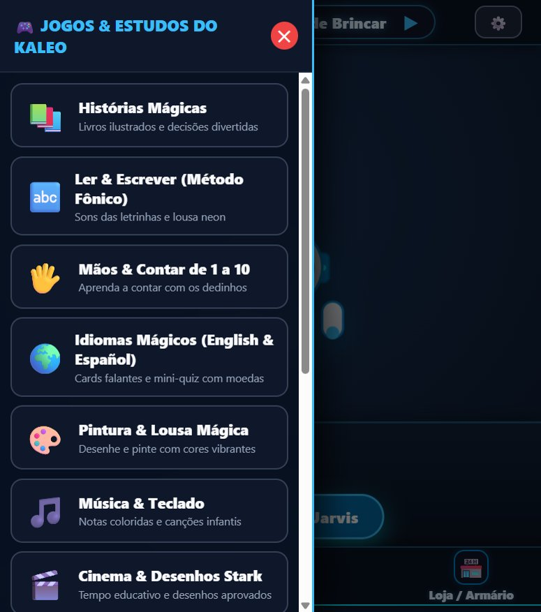

# 🚀 J.A.R.V.I.S. Kids OS v3.4.5 — Stark Educational System (Para Kaleo Noah)

Sistema operacional educativo, companheiro emocional e assistente gamificado estilo **JARVIS do Homem de Ferro**, projetado sob medida com princípios de engenharia de software de alta eficiência para netbooks modestos e computadores com recursos restritos (modelo original **Acer Aspire One / Asus Eee PC** com `Intel Atom 1.6 GHz`, `1 GB a 2 GB RAM`, tela `1024x600`), expandido para arquitetura **multiplataforma universal** compatível com **Linux Kiosk**, **Windows Desktop**, **macOS (.app)** e **Android (.apk autônomo offline)**!

---

## 🌟 Novidades da Versão 3.4

### 🎮 1. Catálogo Expandido para 24 Jogos Educativos (6 Páginas 2x2)
- **Zero Scrollbar no Netbook 1024x600:** Cada página acomoda exatamente 4 jogos em grade 2x2, sem estourar a altura útil da tela.
- **Novos Jogos Didáticos & Científicos:**
  - **🪐 Sistema Solar & Simulador de Gravidade:** Pilote naves espaciais, observe planetas e experimente o simulador de gravidade na Terra ($1.0\times$), Lua ($0.16\times$) e Júpiter ($2.5\times$).
  - **🦁 Reino Animal & Fauna Brasileira:** 12 animais com áudio sintetizado em tempo real, incluindo Onça-Pintada, Mico-Leão-Dourado, Arara-Azul, Lobo-Guará e Tucano.
  - **⏰ Relógio Mágico & Cronômetro de 30s:** Ensino de horas com mostrador analógico/digital e cronômetro gamificado com contagem regressiva sonora para lavar as mãos e escovar os dentes.
  - **🕵️ Detetive Stark (Jogo dos 7 Erros):** Desafios visuais com efeitos sonoros e pistas do robô Jarvis.
  - **🔬 Laboratório de Ciências & Vulcão Químico:** Estados da água (Gelo, Líquido, Vapor), misturador de cores primárias e o experimento do Vulcão Químico (Bicarbonato + Vinagre) com erupção borbulhante e fumaça neon.
  - **♟️ Academia de Xadrez do Pequeno Mestre:** Mini-tabuleiro interativo ensinando o movimento do Peão, Torre e o famoso salto em "L" do Cavalo.
  - **🦖 Parque dos Dinossauros & Fósseis Stark:** Sítio paleontológico com escavação de ossos do Tiranossauro Rex, Braquiossauro e Tricerátops, com rugidos pré-históricos e fatos científicos.
  - **🎨 Lousa Mágica Neon Atualizada:** Novos carimbos colecionáveis (⭐, 🤖, 🚀, 🦖, ❤️, 👑, ⚡).

### 🌤️ 2. Clima e Previsão com Geocodificação Dinâmica em Tempo Real
- **Sincronização com Open-Meteo:** Dados meteorológicos reais para Campo Largo / PR e qualquer município configurado.
- **Previsão de Amanhã Inteligente:** Jarvis agora diferencia com precisão perguntas sobre o clima de hoje vs. previsão do tempo de amanhã (temperatura máxima, mínima e probabilidade de chuva).
- **Resposta por Voz Limpa:** O Jarvis responde a previsão falando naturalmente por voz sem forçar a abertura de janelas ou modais que interrompam a atividade da criança.

### 📱 3. Aplicativo Android 100% Autônomo & Offline (Sem Erro de Porta 8000)
- **Execução Nativa Direta:** O APK Android agora embute todos os templates, jogos, mascote e folhas de estilo dentro do próprio pacote (`assets/` nativo em `file:///android_asset/hud_jarvis.html`), funcionando de forma **100% autônoma e offline** diretamente no celular da criança, sem precisar de servidor rodando ou de IP na porta 8000.
- **Persistência Local (localStorage Fallback):** Fichas, moedas, itens da lojinha e histórico de dicção são mantidos localmente no próprio aparelho da criança.
- **Modo Wi-Fi Opcional com 1 Toque:** Se os pais quiserem conectar o celular ao robô que está rodando no netbook ou PC da casa, basta dar um **toque longo na tela** para abrir o menu de conexão, digitar o IP e alternar na hora.

### 📐 4. Responsividade Mobile & Netbook Kiosk Perfeitas
- **Mascote Adaptável (`clamp`):** O robô Jarvis redimensiona dinamicamente tanto para celulares quanto para netbooks 1024x600.
- **Trava Parental (PIN de 4 Dígitos / Desafio de Adulto):** Acesso ao Painel dos Pais protegido no `/pais`.
- **Cache de RAM de Templates:** O Microdot serve as páginas `/` e `/pais` direto da memória com 0ms de I/O em disco.

---

## 🌟 Novidades da Versão 3.3

### 📱 1. Aplicativo Android 100% Autônomo & Offline (Sem Erro de Porta 8000)
- **Execução Nativa Direta:** O APK Android agora embute todos os templates, jogos, mascote e folhas de estilo dentro do próprio pacote (`assets/` nativo em `file:///android_asset/hud_jarvis.html`), funcionando de forma **100% autônoma e offline** diretamente no celular da criança, sem precisar de servidor rodando ou de IP na porta 8000.
- **Persistência Local (localStorage Fallback):** Fichas, moedas, itens da lojinha e histórico de dicção são mantidos localmente no próprio aparelho da criança.
- **Modo Wi-Fi Opcional com 1 Toque:** Se os pais quiserem conectar o celular ao robô que está rodando no netbook ou PC da casa, basta dar um **toque longo na tela** para abrir o menu de conexão, digitar o IP e alternar na hora. Caso haja queda de conexão na rede, o app reverte imediatamente para o modo offline sem exibir tela de erro do Android!

### 📐 2. Responsividade Mobile Completa (Sem Sobreposições de Tela)
- **Mascote Adaptável (`clamp`):** O robô Jarvis agora redimensiona dinamicamente para se ajustar perfeitamente tanto a telas de smartphones em modo retrato (`max-width: 820px`) quanto paisagem ou netbooks 1024x600.
- **Top Bar & Pílula Central Fluidas:** Eliminadas todas as colisões entre os badges de moedas/bateria e a pílula de localização do cômodo em telas estreitas de 360-420px.
- **Modais com Rolagem Suave no Celular:** Os 17 jogos, a Biblioteca Mágica e a Loja agora abrem em layout vertical com scroll suave e ergonômico no celular, mantendo a regra de **ZERO barras de rolagem** quando em telas de netbook/desktop.

### 🛡️ 3. Trava Parental (PIN de 4 Dígitos / Desafio de Adulto)
- **Parental Gate no `/pais`:** Acesso ao Painel dos Pais protegido por PIN numérico personalizável de 4 dígitos ou desafio de adulto (ex.: *7 × 8 = 56*), impedindo alterações acidentais feitas pelas crianças.
- **Gestão Segura de PIN:** Possibilidade de definir ou alterar o PIN diretamente na interface dos pais, com validação instantânea na API `/api/admin/pin/*`.

### ⚡ 4. Otimizações de CPU & RAM para Netbooks Intel Atom
- **Cache de RAM de Templates:** O Microdot agora serve as páginas `/` e `/pais` diretamente da memória RAM, gerando **0ms de I/O em disco** no HDD lento do netbook.
- **Eliminação de Jitter:** Remoção do `gc.collect()` síncrono por requisição, evitando pausas de 15-40ms na CPU de 1 núcleo do Intel Atom.

### 🌙 5. Modo Noturno Circadiano & Atalhos de Teclado
- **Filtro Noturno Automático:** A partir das 20h00, o sistema ativa uma suave tonalidade âmbar circadiana que reduz a luz azul e prepara os olhos da criança para o sono.
- **Atalhos no Teclado Físico:** Navegue pelos cômodos com `←` / `→`, interaja com o Jarvis usando `Espaço` e feche qualquer janela instantaneamente com `Esc`.

---

## 🌟 Recursos Consolidados da Versão 3.2

### 🗣️ 1. Fonoaudiologia & Dicção do Super-Herói (17º Jogo Oficial)
- **66 Desafios Fonoaudiológicos Completos:**
  - **24 Desafios de Sílabas & Sons Desafiadores:** Trabalho minucioso de articulação infantil cobrindo fonemas R brando na ponta da língua (*Arara*, *Jacaré*, *Coração*, *Careta*, *Pirata*), R forte na garganta (*Rato*, *Robô*, *Rei*, *Rua*, *Rádio*), encontros consonantais com R (*Prato*, *Trator*, *Brasil*, *Dragão*, *Cravo*, *Fruta*, *Grade*), encontros consonantais com L (*Planeta*, *Flauta*, *Globo*, *Clube*, *Blusa*), sons de sibilantes e chiados (*Sapo*, *Sorvete*, *Zebra*, *Chocolate*, *Janela*, *Xícara*) e dígrafos nasais/palatais (*Coelho*, *Golfinho*).
  - **30 Palavras Poderosas & Desafios Gigantes:** Palavras polissílabas infantis de 3 a 7 sílabas, incluindo o lendário campeão **Paralelepípedo** (7 sílabas!), *Astronauta*, *Borboleta*, *Dinossauro*, *Helicóptero*, *Hipopótamo*, *Rinoceronte*, *Escavadeira*, *Submarino*, *Tartaruga*, *Camaleão*, *Espetacular*, *Super-Herói*, *Constelação*, *Transformação*, *Bicicleta*, *Elefante*, *Arco-Íris*, *Computador*, *Telefone*, *Microscópio*, *Relâmpago*, *Joaninha*, *Melancia*, *Paraquedas*, *Tesouro*, *Foguete*, *Castelo*, *Espada* e *Aventura*.
  - **12 Trava-Línguas Divertidos:** Treino de agilidade e ritmo articulatório (*O rato roeu*, *Três pratos de trigo*, *Sapo no saco*, *Doce mais doce*, *Aranha e a rã*, *Sabiá assobiador*, *Pinga a pia*, *O tempo*, *Mafagafos*, *Farofa fofa*, *Bote a bota*, *Peito de Pedro*).
- **✨ Botão: "Nova Palavra Surpresa do Jarvis! 🤖":**
  - O mascote Jarvis escolhe aleatoriamente uma palavra nova da cartola sob demanda, disparando arpeggio musical, chuva de corações/estrelas e expressão feliz nos olhinhos do robô.
  - O robô fala com empolgação: *"Bip bip, super-herói Kaleo! O Jarvis preparou uma palavra mágica nova para você treinar a dicção: [SÍLABAS]! [DICA DA BOQUINHA] Vamos falar juntos?"*.
- **🔉 Botão: "Sílaba por Sílaba":** Pronúncia pausada com cadência fonoaudiológica para a criança imitar cada pedacinho com calma.
- **🎙️ Treino Interativo com Moedas Reais:** A criança treina a fala e recebe elogio do robô com **+5 moedas reais** creditadas no Pote do Tesouro.
- **Comando de Voz Integrado:** Diga *"Jarvis me mostra uma palavra nova"*, *"Jarvis palavra mágica"* ou *"Jarvis treinar dicção"* e o jogo abre sorteando a palavra na hora!

### 🎬 2. Gestão de Tempo de Cinema & Orientação Segura
- **🚫 Botão de Travar / Zerar Cinema nas Ações Rápidas:** Os pais podem interromper ou revogar instantaneamente qualquer tempo residual de vídeo diretamente pelo painel `/pais` via `/api/admin/media/zerar`.
- **Teto Máximo para Bônus de Mídia:** O bônus concedido pelos pais possui teto protetivo (máximo de 45 minutos), evitando acúmulos infinitos de tela.
- **Diálogo Interativo por Voz:** Quando o cinema é liberado por horário ou bônus, o Jarvis anuncia por voz e pergunta gentilmente se a criança deseja assistir agora ou continuar brincando.

### 🛡️ 3. Filtros Rígidos de Segurança Infantil (Child-Safe Guardrails)
- **Sanitização de Respostas:** O módulo `jarvis_brain.py` aplica filtros estritos de segurança infantil que barram termos violentos, inapropriados ou assustadores, além de suprimir alucinações de blocos de código e markdown técnico.
- **Proteção Canônica de Path Traversal:** Bloqueio `403 Forbidden` na rota de estáticos para tentativas de fuga de diretório (`/static/../../`).
- **Rate Limit & Limite de Upload:** Uploads de vídeo e áudio dos pais limitados a 20MB para preservar a memória RAM do netbook contra travamentos (OOM).

### 📦 4. Multiplataforma Universal & GitHub Actions CI/CD (.apk e .app)
- **CI/CD Automatizado:** Compilação em nuvem de todos os pacotes oficiais a cada push ou tag de versão no GitHub Actions:
  - 📱 **Android (.apk):** Aplicativo nativo em modo Fullscreen Landscape para tablets e celulares infantis (`deploy/android_app/`).
  - 🍏 **macOS (.app e .app.zip):** Application Bundle executável para Mac com inicializador Python embutido (`deploy/macos_app/`).
  - 🐧 **Debian Kiosk (.deb):** Pacote instalável com 1 clique para antiX Linux, Raspberry Pi OS e Ubuntu.
  - 🐧 **Linux Standalone (.tar.gz):** Pacote portátil de quiosque para netbooks modestos.
  - 🪟 **Windows Desktop (.zip):** Versão portátil completa com inicializador `.bat` para qualquer PC Windows.
  - 📱 **PWA Móvel dos Pais:** Progressive Web App instalável no smartphone com Service Worker offline e push notifications.

---

## 📸 Capturas de Tela do Sistema em Execução

| 🤖 Tela Principal — Sala de Brincar do Robô Jarvis | 🎮 Central de Jogos & Estudos Paginada |
| :---: | :---: |
|  |  |
| *Mascote Jarvis interativo com clima, economia de moedas, cômodos e status de bateria do notebook* | *17 Jogos infantis paginados em Grid 2x2 com botões táteis grandes e ZERO barras de rolagem* |

| 🗣️ Fonoaudiologia & Dicção do Super-Herói | 📚 Biblioteca Mágica de Virtudes & Histórias |
| :---: | :---: |
|  |  |
| *66 desafios fonoaudiológicos com sílabas neon gigantes, botão de palavra surpresa do Jarvis e fala sílaba por sílaba* | *Livros infantis com virtudes, moral da história e gerador de histórias com IA* |

---

## 🖥️ Especificações de Hardware & Requisitos do Sistema

O **J.A.R.V.I.S. Kids OS** nasceu com uma premissa de engenharia intransigente: **dar vida útil e propósito nobre a computadores antigos e modestos**, transformando um netbook esquecido em um superassistente educativo com inteligência artificial para o aprendizado e desenvolvimento de uma criança.

### 🎯 Hardware Alvo Original de Desenvolvimento
O sistema foi concebido, calibrado e testado originalmente para a linha de netbooks ultra-compactos:
- **Modelo de Referência Principal:** Netbook **Acer Aspire One (532h / D250 / D255)** e **Asus Eee PC (1005 / 1015)**.
- **Processador (CPU):** Intel Atom N450 / N270 / D2500 (1.60 GHz a 1.66 GHz, 1 Núcleo / 2 Threads, x86/x64).
- **Memória RAM:** 1 GB a 2 GB DDR2 / DDR3.
- **Gráficos (GPU):** Intel GMA 3150 / Intel 945GSE integrada (aceleração gráfica 2D básica).
- **Armazenamento:** HDD ou SSD SATA de 160 GB, ou cartão de memória SD.
- **Tela e Resolução:** 10.1 polegadas WSVGA (1024 x 600 pixels) com preenchimento total e modo quiosque tela cheia.
- **Sistema Operacional Recomendado:** **antiX Linux 23/24 (32 bits ou 64 bits)** ou **Windows 7/10 Home**.

---

### 📊 Tabela de Requisitos de Sistema (Mínimos vs. Recomendados)

| Componente | Requisitos Mínimos (Netbook Acer / Asus / PCs Antigos) | Requisitos Recomendados (PCs / Notebooks Modernos) |
| :--- | :--- | :--- |
| **Processador (CPU)** | Intel Atom 1.6 GHz, Intel Celeron antigo, AMD E-Series ou qualquer processador x86/x64 de 1 núcleo | Intel Core i3 / i5, AMD Ryzen 3 / 5 ou Celeron moderno quad-core |
| **Memória RAM** | **1 GB de RAM** *(o backend Microdot consome apenas ~12 a 25 MB de RAM)* | **4 GB a 8 GB de RAM** *(necessário para rodar IA local com Ollama)* |
| **Armazenamento** | **500 MB livres** em disco ou cartão SD | **4 GB a 10 GB livres** *(para pesos dos modelos locais de IA)* |
| **Resolução de Tela** | **1024 x 600 pixels** (10.1") com preenchimento total responsivo sem scrollbars | **1366 x 768**, **1920 x 1080 (Full HD)** ou superior |
| **Áudio & Microfone** | Microfone integrado e alto-falantes estéreo / saída P2 | Microfone USB com cancelamento de ruído e caixas de som |
| **Conexão de Rede** | Wi-Fi 802.11 b/g/n (para síntese de voz neural e APIs na nuvem) | Conexão Wi-Fi ou Ethernet estável |
| **Sistemas Operacionais** | **antiX Linux** (32/64 bits), **Debian minimal**, **Raspberry Pi OS**, **Windows 7/10/11**, **Android**, **macOS** | Windows 10/11, Ubuntu/Debian, Fedora, macOS Sonoma/Sequoia, Android 10+ |

---

## 📦 Matriz de Pacotes & Downloads Oficiais (GitHub Releases)

Os arquivos compilados são gerados automaticamente pelo [GitHub Actions CI/CD](https://github.com/zetra-mini/O.S-EDUCATIVO-PARA-CRIAN-AS/actions) e disponibilizados na aba de **Releases**:

| Formato | Plataforma Alvo | Arquivo de Download | Como Instalar / Executar |
| :--- | :--- | :--- | :--- |
| 🐧 **.deb** | Debian / antiX / Ubuntu / Raspberry Pi OS | `jarvis-kids-os_3.4.4.deb` | `sudo dpkg -i jarvis-kids-os_3.4.4.deb` |
| 📦 **.tar.gz** | Linux Kiosk Standalone (Netbook Atom) | `jarvis-kids-os-3.4.4-linux-desktop.tar.gz` | `tar -xzf jarvis-kids-os-*.tar.gz && ./iniciar_jarvis_linux.sh` |
| 🪟 **.zip** | Windows 7 / 10 / 11 (Desktop) | `jarvis-kids-os-3.4.4-windows-desktop.zip` | Extrair e clicar em `iniciar_jarvis_windows.bat` |
| 📱 **.apk** | Android Celulares & Tablets Infantis | `jarvis-kids-os-3.4.4-android.apk` | Instalar no Android e permitir microfone (Modo Autônomo Offline Nativo) |
| 🍏 **.app** | macOS (Intel & Apple Silicon M1/M2/M3) | `jarvis-kids-os-3.4.4-macos.app.zip` | Extrair e abrir `JARVIS-Kids-OS.app` |
| 📱 **PWA** | Smartphone dos Pais (iOS / Android) | Acesso direto via navegador | Acessar `/pais` e clicar em *Adicionar à Tela Inicial* |

---

## ⚡ Engenharia de Performance & Hardware Restrito

### 1. Servidor Web Ultraleve com Microdot (< 15 MB de RAM)
- O backend opera sobre o **Microdot**, micro-framework assíncrono de pegada de memória mínima.
- **Consumo real medido:** Apenas **9 a 14 MB de RAM**, operando com folga muito abaixo do teto de 30 MB.
- Servido nativamente na porta `http://127.0.0.1:8000`.

### 2. SQLite em Modo WAL & Arquitetura de Acesso Seguro
- Para evitar a falha `SQLITE_BUSY` e o congelamento do disco/SSD por acessos simultâneos, todas as conexões SQLite injetam no momento da abertura:
  ```sql
  PRAGMA journal_mode = WAL;     -- Write-Ahead Logging: leituras e escritas não bloqueiam umas às outras
  PRAGMA synchronous = NORMAL;   -- Reduz chamadas excessivas de fsync ao disco
  PRAGMA temp_store = MEMORY;    -- Força tabelas temporárias e ordenações na memória RAM
  PRAGMA busy_timeout = 5000;    -- Espera até 5 segundos em caso de concorrência antes de falhar
  ```

### 3. Eliminação Absoluta de Áudio sobre Áudio
- Toda emissão de voz neural (`speak()`), chime sonoro ou música aciona previamente `pararTodosAudiosESpeech()`, cancelando requisições TTS em andamento e silenciando sintetizadores do navegador para garantir que nunca ocorra sobreposição de falas.

### 4. Zero Scrollbars & Paginação Tátil
- Todas as interfaces (HUD, Loja, Biblioteca, Prato dos Campeões, Central de 17 Jogos e Academia de Dicção) utilizam containers flexbox com `overflow: hidden; max-height: calc(100vh - 72px)` e navegação anterior/próxima em botões de alta visibilidade, eliminando completamente barras de rolagem.

---

## 🐧 Inicialização Automática no Boot (antiX Linux & Netbooks Dedicados)

Uma das maiores vantagens do JARVIS Kids OS quando instalado no **antiX Linux** (especialmente no Acer Aspire One, Asus Eee PC ou PCs antigos) é a experiência de **Console Educativo Dedicado** (estilo videogame ou eletrodoméstico):

### 🚀 Instalação com 1 Comando no antiX Linux (100% Automático):
Basta baixar o arquivo `.deb` da versão mais recente (ou passar pelo pendrive) e executar no terminal do antiX:

```bash
sudo dpkg -i jarvis-kids-os_3.4.4.deb
```

**Pronto! A partir desse momento, tudo é 100% automático:**
- **Zero configuração manual:** Você **não precisa** ativar o servidor pelo terminal nem digitar comandos toda vez que ligar o netbook.
- **Início Automático no Boot:** O instalador `.deb` configura o serviço de background e a sessão do antiX. Sempre que você ligar ou reiniciar o computador, o Jarvis Kids OS sobe sozinho em tela cheia (modo quiosque 1024x600).
- **Sem senhas ou distrações:** A criança vê apenas o robô Jarvis e seus jogos educativos, sem acesso a menus do sistema, barra de tarefas ou terminal.

---

### 🔄 Como Funciona Toda Vez que Ligar ou Reiniciar:
1. **Zero Senhas (Auto-Login Instantâneo):** O sistema faz o login automático direto no usuário da criança pelo gerenciador **SLiM** (`/etc/slim.conf`) ou **LightDM**, sem travar em telas de senha.
2. **Zero Telas do Linux ou Menus Confusos:** O netbook não abre terminal, painéis ou área de trabalho com ícones soltos.
3. **Direto no Robô Jarvis (Tela Cheia 1024x600):** O arquivo de inicialização de sessão do antiX (`~/.desktop-session/startup`) sobe o backend Python ultraleve e aciona o navegador em modo quiosque (`--kiosk http://127.0.0.1:8000`) em poucos segundos!
4. **Volume Destravado Automaticamente:** O áudio dos alto-falantes e o microfone interno são regulados automaticamente em 85% pelo ALSA no boot, garantindo que o Jarvis fale e ouça a criança imediatamente.

### 🛡️ Blindagem Infantil Anti-Fechamento:
* **Teclas Desativadas:** Teclas e atalhos de sistema que crianças pequenas costumam apertar sem querer (`Alt + F4`, `Alt + Tab`, teclas Windows/Super) são desativados no `~/.icewm/prefoverride` e no Openbox (`rc.xml`).
* **Watchdog de Persistência:** Caso o navegador seja fechado acidentalmente, um laço de monitoramento reabre o Jarvis automaticamente em 2 segundos.
* **Protetor de Tela Desativado:** Comandos `xset s off -dpms` impedem que a tela apague no meio de uma historinha ou jogo.

### 🛠️ Scripts Alternativos de Configuração (Caso instale sem o .deb):
* **Instalação Manual no antiX:**
  ```bash
  bash instalar_antix_kiosk.sh
  ```
* **Ativação Completa de Persistência & Auto-Login pelo Root:**
  ```bash
  sudo bash configurar_boot_automatico.sh
  ```

---

## 🎮 Catálogo dos 24 Jogos & Atividades Educativas (6 Páginas 2x2)

### 📄 Página 1: Alfabetização, Matemática e Linguagens
1. **📚 Biblioteca Mágica de Histórias:** Livros ilustrados interativos e histórias com decisões morais.
2. **🔤 Ler & Escrever (Método Fônico):** Sons de cada letra do alfabeto e escrita na lousa neon.
3. **🖐️ Desafio dos Dedinhos:** Matemática visual e contagem de 1 a 10 com mãozinhas animadas.
4. **🌍 Idiomas Mágicos (English & Español):** Cartões falantes em 3 idiomas e miniquiz com moedas reais.

### 📄 Página 2: Nutrição, Higiene, Arte e Música
5. **🍎 Prato dos Super Campeões:** Educação alimentar lúdica com os 4 grupos de nutrientes essenciais.
6. **🧼 Super Herói Limpinho (Higiene):** 4 missões práticas de autocuidado (dentes, banho, mãos e unhas).
7. **🎨 Pintura & Lousa Mágica Neon:** Lousa artística com pincéis coloridos e salvamento de desenhos.
8. **🎵 Laboratório Musical Stark:** Teclado Dó-Ré-Mi, bateria de ritmo e músicas infantis guiadas.

### 📄 Página 3: Tecnologia, Cultura e Informação
9. **💻 Academia Tech: Mouse, Teclado & Scroll:** Foguete (scroll up), Submarino (scroll down), mira e clique.
10. **🇧🇷 Festas & Datas Comemorativas do Brasil:** Celebrações culturais brasileiras no calendário interativo.
11. **🎬 Cinema & Desenhos Stark:** Gestão segura de tempo de vídeo no YouTube Kids e Netflix.
12. **🌤️ Clima, Geografia & Meu Lugar no Mundo:** Sua cidade, estado, Brasil, mapa e as 4 estações do ano.

### 📄 Página 4: Mente, Emoções e Cognição
13. **🚦 Desafio do Semáforo Stark:** Treino de atenção rápida, reflexos e controle inibitório.
14. **💚 Flor da Calma & Emoções:** Respiração guiada, identificação de sentimentos e regulação emocional.
15. **📦 Baú Leitner da Memória:** Repetição espaçada e memorização inteligente de fatos e conceitos.
16. **🔷 Cores, Formas & Lógica Espacial:** Geometria lúdica com círculos, quadrados, triângulos e estrelas.

### 📄 Página 5: Dicção, Espaço, Natureza e Tempo
17. **🗣️ Fonoaudiologia & Dicção do Super-Herói:** 66 desafios de fala com sílabas neon, dica da boquinha, fala pausada e sorteio de palavras mágicas pelo robô Jarvis!
18. **🪐 Sistema Solar & Planetas do Universo:** Pilote a nave espacial, visite planetas (Marte, Júpiter, Saturno), aprenda curiosidades espaciais e dispute o Quiz Astronauta.
19. **🦁 Reino Animal & Sons da Natureza (Biólogo Stark):** Conheça os animais, ouça sons característicos sintetizados e adivinhe o bicho pelo som no Desafio do Ouvido!
20. **⏰ O Relógio Mágico do Tempo & Horas:** Mostrador analógico e digital interativo, ciclo visual dia/noite e missões de rotina (hora de acordar, almoçar e dormir).

### 📄 Página 6: Raciocínio, Ciências, Estratégia e Aventura Pré-Histórica
21. **🕵️ Detetive Stark: Jogo dos 7 Erros:** Olhos de águia para encontrar detalhes secretos em cenas de alta visibilidade com incentivos do Jarvis.
22. **🔬 Laboratório de Misturas & Ciências:** Misturador de cores primárias (vermelho, azul, amarelo), termômetro dos 3 estados da água (gelo, líquido, vapor) e o super ímã magnético.
23. **♟️ Academia de Xadrez do Pequeno Mestre:** Aprenda o movimento do Peão, Cavalo em L, Torre e grandes jogadas com mini-tabuleiro interativo e dicas do Jarvis.
24. **🦖 Parque dos Dinossauros & Fósseis Stark:** Sítio paleontológico com pincel e martelo para desenterrar fósseis de T-Rex, Braquiossauro e Tricerátops, com rugidos épicos e curiosidades.

---

## 🚀 Como Executar Localmente (Desenvolvimento & Testes)

> 💡 **Para quem usa o Netbook com antiX Linux:** Você **NÃO** precisa clonar o repositório nem rodar comandos no terminal para iniciar o servidor! Basta instalar o pacote `.deb` oficial (`sudo dpkg -i jarvis-kids-os_3.4.4.deb`). O sistema inicia 100% automático no boot.
>
> O passo a passo abaixo é voltado exclusivamente para desenvolvedores ou para quem deseja testar o código manualmente em outros computadores:

### Pré-requisitos (Modo Dev)
- Python 3.10 ou superior
- Navegador moderno (Chromium, Chrome, Edge ou Firefox)

### 🚀 Como colocar no Netbook com antiX Linux (Instalação 100% Automática)

Basta baixar o arquivo `.deb` da versão mais recente nas [Releases do GitHub](https://github.com/zetra-mini/O.S-EDUCATIVO-PARA-CRIAN-AS/releases) (ou passar via pendrive) e executar no terminal do antiX:

```bash
sudo dpkg -i jarvis-kids-os_*.deb
```

Pronto! O sistema do Jarvis já configura inicialização automática no boot do antiX Linux. Ao ligar o netbook ou abrir pelo menu/área de trabalho, o robô Jarvis e todos os 24 jogos abrem sozinhos em tela cheia sem que a criança precise abrir terminal ou digitar comandos! Que o pequeno campeão aproveite muito o seu novo computadorzinho!

### Instalação em Modo de Desenvolvimento
```bash
git clone https://github.com/zetra-mini/O.S-EDUCATIVO-PARA-CRIAN-AS.git
cd O.S-EDUCATIVO-PARA-CRIAN-AS
pip install -r requirements.txt
```

### Inicialização Manual do Servidor
```bash
python run_server.py 8000
```
- Interface da criança: `http://localhost:8000`
- Painel dos pais: `http://localhost:8000/pais`

---

## 📱 Painel dos Pais (`/pais`)

Acessível por qualquer smartphone, tablet ou computador na mesma rede Wi-Fi (`http://[IP-DO-NETBOOK]:8000/pais`):
- **Ações Rápidas com 1 Toque:** Liberar ou travar cinema, pausar para refeição, acionar alarme de escovar dentes ou guardar brinquedos.
- **Pote do Tesouro:** Gerenciamento do saldo de moedas e aprovação de resgates da vida real.
- **Mensagens & Recados com Áudio/Vídeo:** Envio de bilhetes carinhosos com confirmação de leitura pela criança.
- **Configurações de Voz Neural:** Seleção entre 11 vozes neurais brasileiras com prioridade total no sistema.
- **Geografia Ensinável:** Configuração de cidade, estado e país para ensinar à criança sua localização no planeta Terra.
- **Logs & Diagnóstico em Tempo Real:** Monitoramento de eventos, bateria do notebook e integridade do banco SQLite.

---

## 🛡️ Licença e Dedicação

Desenvolvido com amor, carinho e dedicação paterna para **Kaleo Noah**, unindo a mais avançada psicologia do desenvolvimento infantil à engenharia de software de alta eficiência.
